# Ignite Lab — a virtual training lab for hands-on courses

Course delivery for practical subjects: lessons, live sessions, an interactive 3D drill-lab module and role-separated staff accounts — built on Supabase so there is no server to maintain.

`React` · `Vite` · `Tailwind CSS` · `Supabase (Postgres + Auth)` · `3D models`

---

## What it is

A training platform for a lab-based course, where the practical part cannot simply be a PDF. Students get course content and live sessions; the drill-lab module gives them a 3D environment to practise in; teachers get their own view of the cohort; admins approve who may teach what.

## Features

- **Courses and enrolment** — structured lessons per course, with progress
- **Live sessions** — scheduled per course, with an upgrade path for joining
- **3D drill-lab module** — interactive practice environment with custom models
- **Teacher authorisation** — a teacher only manages the courses they are approved for
- **Safety and password upgrades** — schema migrations that move accounts to hashed passwords and tighten sign-up
- **Analytics setup** — the database-side groundwork for course-level reporting

## Schema migrations

The SQL files at the repo root are the history of the data model, applied in this order:

```
supabase_setup.sql               core tables
analytics_setup.sql              reporting views
admin_upgrade.sql                admin role and permissions
teacher_authorization.sql        teacher ↔ course permissions
password_security_upgrade.sql    hashed passwords, stricter auth
live_session_upgrade.sql         scheduled sessions
hardware_lab_setup.sql           lab resources per course
sync_teacher_roles.sql           role data repair
fix_signup_trigger.sql           sign-up trigger correction
```

Keeping migrations as ordered, reviewable SQL — rather than clicking through a dashboard — is the reason this project was worth building: the schema change history is readable.

## Run it

```bash
npm install
npm run dev
```

Environment:

```
VITE_SUPABASE_URL=...
VITE_SUPABASE_ANON_KEY=...
```

Then apply the SQL files in order in the Supabase SQL editor. They are written to be idempotent enough to re-run while developing.

## Security notes

- Every table needs RLS enabled; the anon key is public and is not a permission system.
- Teacher permissions are duplicated in the UI for usability but the database policy is the authority.
- The 3D assets are large — `3D models/` accounts for most of this repository's size. They are served as static files; a production build would move them to object storage with cache headers.

## Limitations

- No automated tests — the migrations were verified by hand against a fresh project.
- Live sessions track scheduling and access, not in-app video; a third-party media provider would be needed.
- One tenant only: the schema assumes a single institution.

---

**Md. Abir Ul Islam** · [GitHub](https://github.com/abir2022) · [LinkedIn](https://www.linkedin.com/in/md-abir-ul-islam/)
